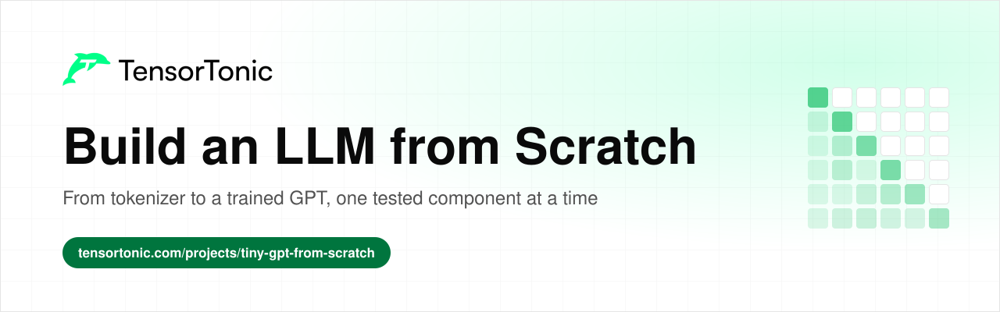
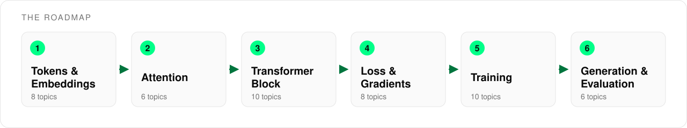

# Build an LLM from Scratch

  

This is a roadmap for building a small GPT-style language model yourself, one component at a time. It covers 48 topics across six stages, from turning text into tokens to sampling new text from a trained model.

Every topic links to an explanation and to practice problems where you implement that component in Python and check your code against tests. When every piece passes its tests on its own, putting them together into a model that trains is much less mysterious.

## Table of Contents

- [Who this is for](#who-this-is-for)
- [How to use this roadmap](#how-to-use-this-roadmap)
- [Stage 1: Tokens and Embeddings](#stage-1-tokens-and-embeddings)
- [Stage 2: Attention](#stage-2-attention)
- [Stage 3: The Transformer Block](#stage-3-the-transformer-block)
- [Stage 4: Loss and Gradients](#stage-4-loss-and-gradients)
- [Stage 5: Training](#stage-5-training)
- [Stage 6: Generation and Evaluation](#stage-6-generation-and-evaluation)
- [What's next](#whats-next)

## Who this is for

This roadmap is for anyone who has used language models and wants to know what happens inside one.

- If you are a **student**, go through the stages in order and write each component before you move to the next.
- If you are **preparing for interviews**, the attention, transformer block and training stages cover the LLM coding questions that come up most often.
- If you already **work with LLMs**, use the tables as a checklist and implement the parts you have only ever called from a library.

You need comfortable Python and basic NumPy. You do not need a GPU, since every problem runs on small arrays.

## How to use this roadmap

The stages follow the path of data through a model. Text becomes tokens and vectors, attention mixes information between positions, the transformer block processes it, the loss measures the error, training reduces it, and generation turns the trained model back into text.

For each topic, read the explanation first, then solve one or two practice problems. Topics without a practice link still matter, because later components assume you understand them.

## Stage 1: Tokens and Embeddings

A model cannot read characters, so text first has to become a sequence of integer IDs and then a sequence of vectors. This stage covers how a byte-pair-encoding tokenizer learns its vocabulary, how token IDs become embeddings, and how the model is told where each token sits in the sequence.

| Topic | Read | Practice |
| --- | --- | --- |
| Splitting text into tokens | [Tokenization in the Transformer](https://www.tensortonic.com/research/transformer/transformers-tokenization) | [Word Count Dictionary](https://www.tensortonic.com/problems/word-count-dict) |
| Training a BPE tokenizer | | [Train a BPE Tokenizer From Scratch](https://www.tensortonic.com/problems/cs336-l01-train-byte-pair-encoding) |
| Encoding text with BPE merges | | [Apply Ranked BPE Merges](https://www.tensortonic.com/problems/cs336-l01-apply-bpe-merge-ranks) |
| Padding sequences into a batch | | [Pad Sequences](https://www.tensortonic.com/problems/pad-sequences) |
| One-hot vectors | | [One-Hot Encoding (Multi-class)](https://www.tensortonic.com/problems/one-hot-encoding) |
| Token embeddings | [Embeddings in the Transformer](https://www.tensortonic.com/research/transformer/transformers-embedding) | |
| Sinusoidal positional encoding | [Transformer Positional Encoding](https://www.tensortonic.com/research/transformer/transformers-positional-encoding) | [Sinusoidal Positional Encoding](https://www.tensortonic.com/problems/positional-encoding) |
| Rotary position embeddings | [RoPE: Rotary Position Embedding Explained](https://www.tensortonic.com/llm-internals/rope) | [RoPE: Rotary Query and Key Embeddings](https://www.tensortonic.com/problems/cs336-l03-rotary-query-key-embeddings) |

## Stage 2: Attention

Attention is the step where each token looks at the tokens before it and pulls in the information it needs. A language model uses a causal mask so that a token can only see the past, which is what makes next-token prediction an honest task.

| Topic | Read | Practice |
| --- | --- | --- |
| Queries, keys and values | [Attention in LLMs: Queries, Keys and Values Explained](https://www.tensortonic.com/llm-internals/attention-mechanism) | [Named-Dimension Batched Attention Scores](https://www.tensortonic.com/problems/cs336-l02-einsum-attention-scores) |
| Stable softmax | | [Numerically Stable Softmax](https://www.tensortonic.com/problems/softmax-function) |
| Scaled dot-product attention | [Scaled dot-product attention](https://www.tensortonic.com/research/transformer/transformers-attention) | [Scaled Dot-Product Attention](https://www.tensortonic.com/problems/la-scaled-attention) |
| Causal masking | [GPT Pretraining: How Next-Token Prediction Works](https://www.tensortonic.com/llm-internals/gpt-pretraining) | [Causal Masking for Attention](https://www.tensortonic.com/problems/causal-masking) |
| Multi-head attention | [Multi-head attention in the Transformer](https://www.tensortonic.com/research/transformer/transformers-multi-head-attention) | [Multi-Head Attention](https://www.tensortonic.com/problems/dl-multi-head-attention) |
| Grouped-query attention | | [Causal Grouped-Query Attention](https://www.tensortonic.com/problems/cs336-l03-causal-grouped-query-attention) |

## Stage 3: The Transformer Block

A transformer block wraps attention with normalization, a feed-forward network and residual connections, and a GPT model is a stack of these blocks. Once you can write one block and count its parameters, the full model is mostly repetition.

| Topic | Read | Practice |
| --- | --- | --- |
| Linear layers | | [Linear Layer Forward Pass](https://www.tensortonic.com/problems/linear-layer-forward) |
| Weight initialization | | [Xavier Initialization](https://www.tensortonic.com/problems/xavier-initialization) |
| Layer normalization | [Layer Normalization in the Transformer](https://www.tensortonic.com/research/transformer/transformers-layer-normalization) | [Layer Normalization](https://www.tensortonic.com/problems/dl-layer-normalization) |
| RMSNorm | | [RMSNorm Forward Pass](https://www.tensortonic.com/problems/cs336-l03-rmsnorm-forward) |
| GELU activation | | [GELU Activation](https://www.tensortonic.com/problems/gelu) |
| Feed-forward network | [Feed-forward layer in the Transformer](https://www.tensortonic.com/research/transformer/transformers-feed-forward) | [Evaluate a Multi-Layer Perceptron](https://www.tensortonic.com/problems/autograd-l07-mlp-forward) |
| SwiGLU | | [Parameter-Matched SwiGLU Block](https://www.tensortonic.com/problems/cs336-l03-parameter-matched-swiglu) |
| Dropout | | [Dropout (Training Mode)](https://www.tensortonic.com/problems/dropout-training) |
| Residual stream and the full block | [The Transformer encoder block](https://www.tensortonic.com/research/transformer/transformers-encoder-block) | [Transformer Decoder Block](https://www.tensortonic.com/problems/dl-decoder-block) |
| Parameter and FLOP counts | | [Transformer Training FLOP Estimator](https://www.tensortonic.com/problems/cs336-l02-training-flop-estimator) |

## Stage 4: Loss and Gradients

The model learns by comparing its predicted next token with the real one and pushing the error back through every layer. This stage builds a small autograd engine, so the backward pass stops being a black box and you can check every gradient against finite differences.

| Topic | Read | Practice |
| --- | --- | --- |
| Next-token prediction | [GPT Pretraining: How Next-Token Prediction Works](https://www.tensortonic.com/llm-internals/gpt-pretraining) | [Bigram Probabilities (Add-1 Smoothing)](https://www.tensortonic.com/problems/bigram-probabilities) |
| Cross-entropy loss | [Cross-Entropy Loss: Formula and BCE vs MSE](https://www.tensortonic.com/ml-math/information-theory/cross-entropy) | [Cross-Entropy Loss](https://www.tensortonic.com/problems/cross-entropy-loss) |
| Finite-difference derivatives | [Build Micrograd from Scratch](https://www.tensortonic.com/study-plans/autograd-from-scratch) | [Finite Difference Derivative](https://www.tensortonic.com/problems/autograd-l01-finite-difference-derivative) |
| Computational graphs | [The Chain Rule in Backpropagation](https://www.tensortonic.com/ml-math/calculus/chain-rule) | [Build a Scalar Expression Graph](https://www.tensortonic.com/problems/autograd-l02-build-expression-graph), [Topologically Sort a Computation DAG](https://www.tensortonic.com/problems/autograd-l05-topological-sort) |
| Reverse-mode autodiff | [Backpropagation and Gradient Descent by Hand](https://www.tensortonic.com/ml-math/calculus/backpropagation) | [Run Reverse-Mode Autodiff](https://www.tensortonic.com/problems/autograd-l05-reverse-mode-autodiff), [Accumulate Shared-Path Gradients](https://www.tensortonic.com/problems/autograd-l06-shared-path-gradient-accumulation) |
| Local backward rules | | [Apply Local Vector-Jacobian Rules](https://www.tensortonic.com/problems/autograd-l05-local-vjp-rules), [Differentiate Exponentials and Powers](https://www.tensortonic.com/problems/autograd-l06-exp-power-backward) |
| Gradient checking | | [Gradient-Check an Autodiff Graph](https://www.tensortonic.com/problems/autograd-l05-autodiff-gradient-check) |
| Softmax and cross-entropy gradient | | [Softmax + Cross-Entropy Gradient](https://www.tensortonic.com/problems/calculus-softmax-ce-gradient) |

## Stage 5: Training

With a model, a loss and gradients in place, training is a loop that feeds batches, updates weights and keeps the updates stable. Most of the work is in the optimizer and the learning rate schedule, and in knowing what to check when the loss refuses to fall.

| Topic | Read | Practice |
| --- | --- | --- |
| Mini-batches | [SGD, Mini-Batch and Learning Rate Schedules](https://www.tensortonic.com/ml-math/optimization/sgd-variants) | [Batch Shuffling & Mini-Batch Generator](https://www.tensortonic.com/problems/batch-generator) |
| A full training step | | [Apply One Full SGD Training Step](https://www.tensortonic.com/problems/autograd-l08-sgd-training-step), [Train a Tiny Micrograd MLP](https://www.tensortonic.com/problems/autograd-l08-train-tiny-micrograd-mlp) |
| Adam | [Adam vs RMSprop vs AdaGrad Explained](https://www.tensortonic.com/ml-math/optimization/adaptive-rates) | [Adam Optimizer Step](https://www.tensortonic.com/problems/adam-optimizer) |
| AdamW and weight decay | [Which Optimizer to Use in Deep Learning](https://www.tensortonic.com/guides/which-optimizer-to-use) | [AdamW (Decoupled Weight Decay)](https://www.tensortonic.com/problems/adamw-optimizer) |
| Warmup and decay | | [Warmup + Linear Decay LR Schedule](https://www.tensortonic.com/problems/warmup-decay-lr), [Cosine Annealing LR Scheduler](https://www.tensortonic.com/problems/cosine-annealing-lr) |
| Warmup-stable-decay schedules | | [Generate a Warmup-Stable-Decay Schedule](https://www.tensortonic.com/problems/cs336-l11-wsd-learning-rate) |
| Gradient clipping | | [Gradient Clipping (Global Norm)](https://www.tensortonic.com/problems/gradient-clipping) |
| Gradient accumulation | [Gradient Accumulation in LLM Training](https://www.tensortonic.com/llm-internals/gradient-accumulation) | [Gradient Accumulation Equivalence](https://www.tensortonic.com/problems/cs336-l02-gradient-accumulation-step) |
| Mixed precision and memory | [Mixed Precision Training: FP16 vs BF16](https://www.tensortonic.com/llm-internals/mixed-precision) | [Mixed-Precision Training Memory Accountant](https://www.tensortonic.com/problems/cs336-l02-training-memory-accountant) |
| Debugging a loss that will not fall | [Training Loss Not Decreasing? Causes and Fixes](https://www.tensortonic.com/guides/training-loss-not-decreasing) | |

## Stage 6: Generation and Evaluation

A trained model outputs a probability for every token in the vocabulary, and the decoding rule decides what text you actually see. This stage covers the common sampling methods, how to measure a model with perplexity and likelihood scores, and the caching tricks that make generation fast.

| Topic | Read | Practice |
| --- | --- | --- |
| Temperature sampling | | [Text Generation Sampling](https://www.tensortonic.com/problems/nlp-text-generation-sampling) |
| Top-k and top-p sampling | | [Temperature, Top-k, and Top-p Sampling](https://www.tensortonic.com/problems/inference-token-sampling) |
| Perplexity | [Perplexity in LLMs: Formula and Worked Example](https://www.tensortonic.com/ml-math/information-theory/perplexity) | [Perplexity Computation](https://www.tensortonic.com/problems/perplexity-computation), [Compute Conditional Perplexity](https://www.tensortonic.com/problems/cs336-l12-conditional-perplexity) |
| Scoring answers by likelihood | | [Score Multiple-Choice Continuations](https://www.tensortonic.com/problems/cs336-l12-multiple-choice-likelihood) |
| KV cache | [KV Cache in LLMs: How It Makes Inference Fast](https://www.tensortonic.com/llm-internals/kv-cache) | [Decode Attention with a KV Cache](https://www.tensortonic.com/problems/cs336-l10-kv-cache-decode-step) |
| Speculative decoding | [Speculative Decoding in LLMs Explained](https://www.tensortonic.com/llm-internals/speculative-decoding) | [Perform Exact Speculative Sampling](https://www.tensortonic.com/problems/cs336-l10-speculative-sampling) |

## What's next

Once each component passes its tests, the [Build a Tiny GPT from Scratch](https://www.tensortonic.com/projects/tiny-gpt-from-scratch) project puts them together into one model that you train end to end. The guide [How to Build an LLM from Scratch](https://www.tensortonic.com/guides/build-an-llm-from-scratch) walks through the same six stages in prose, with the checks to run when you join the pieces and the mistakes to avoid.

After a tiny GPT, these are the directions a production model takes after pretraining. Each row has an explanation and something to build.

| Direction | Read | Build |
| --- | --- | --- |
| Scale the same model up | [FlashAttention](https://www.tensortonic.com/llm-internals/flash-attention) | [Language Modeling from Scratch](https://www.tensortonic.com/study-plans/language-modeling-from-scratch) |
| Fine-tune a pretrained model | [LoRA](https://www.tensortonic.com/llm-internals/lora), [QLoRA](https://www.tensortonic.com/llm-internals/qlora) | [Fine-Tune an LLM](https://www.tensortonic.com/projects/llm-finetuning) |
| Align a model with preferences | [RLHF](https://www.tensortonic.com/llm-internals/rlhf), [DPO](https://www.tensortonic.com/llm-internals/dpo) | [DPO from Scratch](https://www.tensortonic.com/projects/dpo-from-scratch) |
| Serve a model quickly | [KV cache](https://www.tensortonic.com/llm-internals/kv-cache), [PagedAttention](https://www.tensortonic.com/llm-internals/paged-attention) | [Build an LLM Inference Server](https://www.tensortonic.com/projects/llm-inference) |
| Shrink a model | [Quantization](https://www.tensortonic.com/llm-internals/quantization) | [Quantize a Language Model to 4 Bits](https://www.tensortonic.com/projects/quantization-from-scratch) |
| Ground a model in documents | [RAG](https://www.tensortonic.com/llm-internals/rag) | [RAG from Scratch](https://www.tensortonic.com/projects/rag-from-scratch) |

The [Language Modeling from Scratch](https://www.tensortonic.com/study-plans/language-modeling-from-scratch) study plan continues into scaling laws, distributed training, inference systems and alignment, and the [LLM Internals](https://www.tensortonic.com/llm-internals) pages explain the techniques used in production models.

To study the architecture on its own, the [Implement a Transformer from Scratch](https://www.tensortonic.com/guides/implement-a-transformer-from-scratch) guide explains how to build the original Transformer layer by layer, and the [How to Fine-Tune an LLM](https://www.tensortonic.com/guides/how-to-fine-tune-an-llm) guide explains how to adapt a pretrained model to a new task.

## License

MIT
